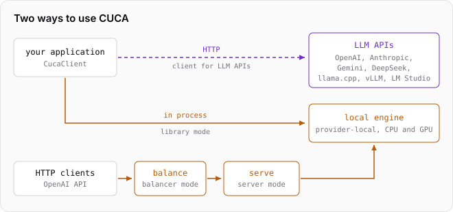
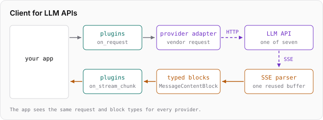
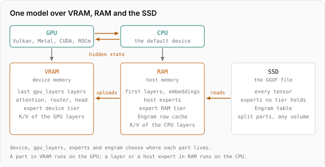
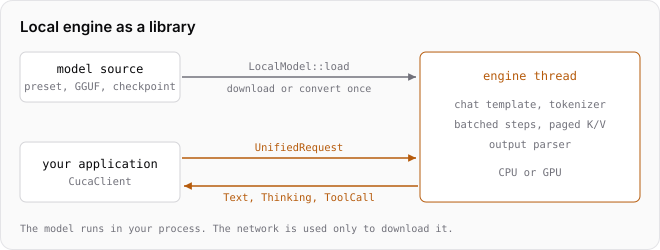
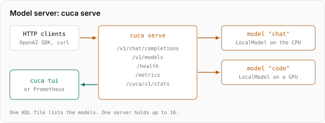
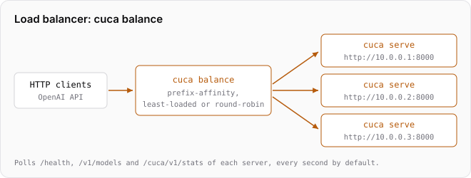

# CUCA

**Compact Universal Client for Agents**

> Legendary vigilant witch; small footprint that constantly watches for responses.

[](https://nassor.github.io/cuca/)
[](https://crates.io/crates/cuca)
[](https://github.com/nassor/cuca/actions/workflows/ci.yml)
[](LICENSE)
[](https://www.rust-lang.org)

CUCA is a Rust crate for language models, used in two ways:

- A client for LLM APIs. One request type and one stream of typed replies work with OpenAI, Anthropic, Gemini, DeepSeek, llama.cpp, vLLM and LM Studio.
- A local engine, `provider-local`, that runs the model itself on your CPU, your GPU or both, and spreads a model larger than either memory over VRAM, RAM and the SSD. It runs in three modes: as a library inside your program, as an OpenAI-compatible server (`cuca serve`), and as a load balancer over several servers (`cuca balance`).



Nothing compiles by default: you pick Cargo features, and the build fails until at least one provider is on. The [features page](https://nassor.github.io/cuca/reference/features/) lists them all.

## Client for LLM APIs



You build a `UnifiedRequest`, and `CucaClient::generate_stream` returns a stream of `MessageContentBlock` values (`Text`, `Thinking`, `ToolCall` and others), whichever provider answers. The SSE parser reuses one buffer and copies a frame only when it emits an event. The [Quick start](#quick-start) streams a first reply.

- [Providers](https://nassor.github.io/cuca/providers/): `provider-openai` (also Ollama and any OpenAI-compatible server), `provider-anthropic`, `provider-deepseek`, `provider-gemini`, `provider-llamacpp`, `provider-vllm` and `provider-lmstudio`.
- [Plugins](https://nassor.github.io/cuca/plugins/) watch the request and the stream: MCP, WASM sandbox, memory, guardrails, subagents, human approval, web search, skills, telemetry, session log, cost accounting and redaction.
- [Services](https://nassor.github.io/cuca/services/) are called directly: prompt cache, entity extraction, session replay, speculative fast/slow routing, rate limiting, a vector store and a call scheduler.
- The request carries one thinking effort, `minimal` to `xhigh`, mapped onto each provider's reasoning control and ignored by providers without one. It also carries the sampling fields `temperature`, `max_tokens`, `top_p`, `top_k`, `seed` and `stop`; a field the backend has no equivalent for returns `CucaError::Config`.

## Local engine

`provider-local` runs a GGUF model in Rust, with no llama.cpp and no FFI written by cuca: candle on the CPU, burn and CubeCL on a GPU through the `provider-local-vulkan`, `-metal`, `-cuda` or `-rocm` feature. It reads the architecture from the file and supports 20, among them Gemma 4, Qwen 3.5, Mistral Small 4 and DeepSeek-V4.1. A preset name downloads a pinned file, and a Hugging Face safetensors checkpoint is converted once to a cached GGUF. See [Local models and formats](https://nassor.github.io/cuca/providers/local/models/) and [Model sources](https://nassor.github.io/cuca/providers/local/model-sources/).

### VRAM, RAM and SSD



A model does not have to fit one memory. The GGUF file stays on the SSD, and four keys choose which parts move into RAM or VRAM, and whether the CPU or the GPU computes them:

- `gpu_layers` runs the last layers on the GPU and the first ones on the CPU, as llama.cpp's `-ngl` does.
- `experts { host; }` keeps a mixture of experts' routed experts in RAM for the CPU, while attention, the router and the head run on the GPU.
- `experts { tiered ... }` leaves the experts in the file and caches the hottest ones in RAM (`ram_bytes`) and VRAM (`device_bytes`). Output equals a resident load's, bit for bit on the CPU and to float rounding on a GPU.
- `engram` bounds the RAM cache of DeepSeek-V4.1's Engram table, which also stays in the file.

Qwen3.6-35B-A3B is a 20.84 GB file; on a 16 GB GPU it runs with 4 GiB of experts in VRAM, 12 GiB in RAM and the rest read from the SSD on demand. Save this as `moe.kdl` and run it from the repository root; the command runs the same on Linux, macOS and Windows (PowerShell):

```kdl
source "qwen3.6-35b-a3b-q4_0"
device "vulkan"
experts { tiered device_bytes="4g" ram_bytes="12g"; }
```

```
cargo run --release --example local_model --features provider-local-vulkan -- --config moe.kdl
```

The same keys go in a `model` node of `cuca serve`'s file, and in library mode they are the fields of `LocalModelConfig`. On an RX 9070 XT (16 GB) with 125 GB of RAM, Muse Glimmer 30B (16.27 GB) decodes at 8.3 tokens/s with 38 of 52 layers on the GPU, against 3.5 on the CPU alone. DeepSeek-V4.1, a 507 GB converted set, runs from an NVMe SSD behind 90 GiB of expert cache in RAM: 2.15 tokens/s on the CPU alone, 1.96 with attention on the GPU in 12.5 GiB of VRAM. [Hybrid placement](https://nassor.github.io/cuca/providers/local/placement/) lists every combination and its measurements.

### Library mode



The model runs inside your program, through the same `CucaClient` as the HTTP providers. With `cuca` added with `--features provider-local`, plus `tokio` and `futures-util`:

```rust
use cuca::types::{MessageContentBlock, ProviderEndpoint};
use cuca::{CucaClient, LocalModel, LocalModelConfig, UnifiedRequest};
use futures_util::StreamExt;

#[tokio::main]
async fn main() -> Result<(), Box<dyn std::error::Error>> {
    // Downloads the default model, Gemma 4 E2B Q4_0 (2.84 GB), on first use.
    let model = LocalModel::load(LocalModelConfig::default()).await?;
    let client = CucaClient::builder()
        .with_provider(ProviderEndpoint::Local)
        .with_local_model(model)
        .build()?;

    let request = UnifiedRequest::new("local").add_user_message("Explain CUCA in one sentence.");
    let mut stream = client.generate_stream(request).await?;
    while let Some(block) = stream.next().await {
        if let MessageContentBlock::Text(text) = block? {
            print!("{text}");
        }
    }
    Ok(())
}
```

The [Local page](https://nassor.github.io/cuca/providers/local/) covers the presets, the GPU features and the build flags.

### Server mode



`cuca serve` answers `POST /v1/chat/completions` the way vLLM and llama.cpp's server do, with Prometheus metrics and a stats API. It reads one KDL file. Save this as `cuca.kdl`:

```kdl
serve {
    stats_api #true

    model {
        source "qwen3-0.6b-q8_0"
    }
}
```

Start it from the repository root; this command runs the same on Linux, macOS and Windows (PowerShell):

```
cargo run --release --no-default-features --features server --bin cuca -- serve --config cuca.kdl
```

The server listens on `http://127.0.0.1:8000`. The [Serve a model over HTTP](https://nassor.github.io/cuca/guides/serve-a-model/) guide sends a first chat completion and opens the terminal UI.

### Balancer mode



`cuca balance` spreads chat requests over several `cuca serve` instances and streams each answer back unchanged. Its default policy keeps a conversation on the server that already caches its prompt prefix. It reads the `balance` section of the same file:

```kdl
balance {
    listen "127.0.0.1:8080"
    upstreams "http://10.0.0.1:8000" "http://10.0.0.2:8000"
}
```

```
cargo run --release --no-default-features --features server --bin cuca -- balance --config cuca.kdl
```

The [Balancer page](https://nassor.github.io/cuca/server/balancer/) covers the policies, health checks and retries.

## Quick start

This streams a reply from a model served by llama.cpp through the client. Prerequisites: Rust 1.98 or newer, a checkout of this repository, and `llama-server` from llama.cpp with a Gemma 4 E4B GGUF file. About 15 minutes end to end. Every `cargo` command below runs the same on Linux, macOS and Windows (PowerShell).

1. Start the model server in its own terminal and leave it running. Replace `/path/to/model.gguf` with your GGUF file. The `google/gemma-4-e4b` repository on Hugging Face holds safetensors, so `llama-server -hf` cannot load it.

   ```
   llama-server -m /path/to/model.gguf --port 1234 --alias google/gemma-4-e4b
   ```

   From a second terminal, check that it serves the model.

   Linux/macOS:

   ```
   curl http://127.0.0.1:1234/v1/models
   ```

   Windows (PowerShell):

   ```
   curl.exe http://127.0.0.1:1234/v1/models
   ```

   You see a JSON object whose `data` array contains an entry with `"id": "google/gemma-4-e4b"`.

2. Create the demo crate and enter it.

   ```
   cargo new cuca-demo
   cd cuca-demo
   ```

   You see ``Creating binary (application) `cuca-demo` package``.

3. Add CUCA from your checkout with the llama.cpp provider. Replace `/path/to/cuca` with the path of this repository.

   ```
   cargo add cuca --path /path/to/cuca --features provider-llamacpp
   ```

   You see `Adding cuca (local) to dependencies`, then the feature list with `+ provider-llamacpp` enabled.

4. Add the async runtime and the stream extension trait.

   ```
   cargo add tokio --features macros,rt-multi-thread
   cargo add futures-util
   ```

   Each command prints `Adding <name> v<version> to dependencies`.

5. Replace `src/main.rs` with the demo below. The llama.cpp adapter defaults to `http://127.0.0.1:8080`, so the demo sets port 1234. No API key is needed.

   ```rust
   use cuca::types::{MessageContentBlock, ProviderEndpoint};
   use cuca::{CucaClient, UnifiedRequest};
   use futures_util::StreamExt;

   #[tokio::main]
   async fn main() -> Result<(), Box<dyn std::error::Error>> {
       let client = CucaClient::builder()
           .with_provider(ProviderEndpoint::LlamaCpp)
           .with_base_url("http://127.0.0.1:1234/v1")
           .build()?;

       let request = UnifiedRequest::new("google/gemma-4-e4b")
           .add_system_message("You are concise.")
           .add_user_message("Explain CUCA in one sentence.");

       let mut stream = client.generate_stream(request).await?;
       while let Some(chunk) = stream.next().await {
           if let Ok(MessageContentBlock::Text(text)) = chunk {
               print!("{text}");
           }
       }
       Ok(())
   }
   ```

6. Run the demo.

   ```
   cargo run
   ```

   Gemma 4 E4B's reply streams to your terminal and the process exits when it ends. The demo prints `Text` blocks and drops `Thinking` ones, so a reasoning model shows nothing until its reasoning is done.

Next: any OpenAI-compatible server (Ollama at `http://localhost:11434/v1`, vLLM, a remote gateway) works with `provider-openai`, a different `with_base_url` and your model name. The `examples/` folder has a runnable demo for the client, every plugin and every service; most take `--base-url` and `--model` after `--`.

## Run the live tests

With a chat model on `http://127.0.0.1:1234` (a llama.cpp server works), run this on Linux, macOS and Windows (PowerShell):

```
cargo test --features "provider-llamacpp plugin-mcp plugin-sandbox plugin-memory service-entity-extraction plugin-guardrails plugin-subagent plugin-hitl plugin-web-search plugin-skills plugin-telemetry service-speculative plugin-session-log service-replay service-prompt-cache plugin-cost service-rate-limit service-vector-store plugin-redaction service-scheduler" -- --nocapture --test-threads=1
```

Without a reachable server, the tests print `SKIP` and pass. To target another server or make a skip fail, copy `cuca-test.example.kdl` to `cuca-test.kdl`, edit it, and add `config-kdl` to the features. The [integration tests guide](https://nassor.github.io/cuca/guides/integration-tests/) has the steps.

## License

Licensed under the Apache License, Version 2.0 (the "License"); you may not use this project except in compliance with the License. You may obtain a copy of the License at <http://www.apache.org/licenses/LICENSE-2.0>.

Unless required by applicable law or agreed to in writing, software distributed under the License is distributed on an "AS IS" BASIS, WITHOUT WARRANTIES OR CONDITIONS OF ANY KIND, either express or implied. See the License for the specific language governing permissions and limitations under the License.

Copyright 2026 Nassor Frazier-Silva <nassor@gmail.com>
